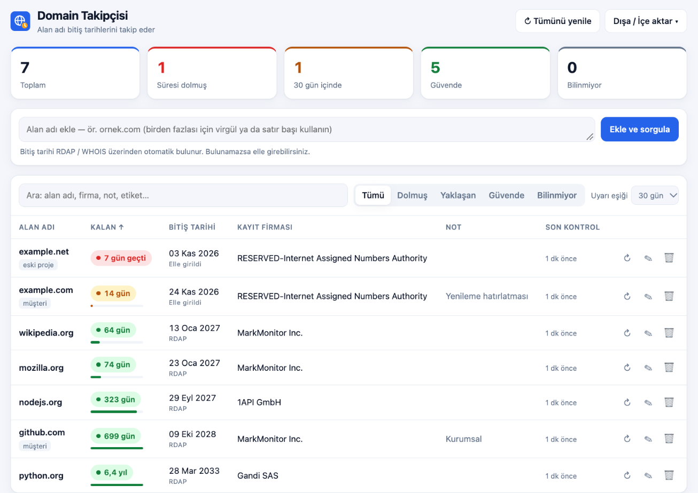
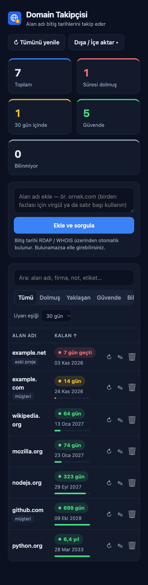

# Domain Takipçisi

[](https://github.com/harunercoban2/domain-takipcisi/actions/workflows/test.yml)


[](LICENSE)

Alan adı bitiş tarihlerini takip eden, kurulum gerektirmeyen küçük bir web uygulaması.
Alan adını yazarsınız; bitiş tarihi, kayıt firması ve DNS sunucuları **RDAP / WHOIS** üzerinden
otomatik bulunur. Süresi yaklaşanlar renkli rozetlerle öne çıkar.



## Özellikler

- Alan adını yazın → bitiş tarihi, kayıt firması, DNS sunucuları **RDAP / WHOIS** üzerinden otomatik bulunur
- Toplu ekleme (virgül, boşluk ya da satır başıyla ayrılmış liste yapıştırın, tek seferde 200'e kadar)
- Kalan gün rozetleri: **süresi dolmuş / yaklaşan / güvende / bilinmiyor**, ayarlanabilir uyarı eşiği (7–90 gün)
- Arama, filtreleme, sütuna göre sıralama
- Not, etiket ve elle bitiş tarihi girme (sorgulanamayan uzantılar için)
- Arka planda her gün otomatik yenileme
- Dışa aktarma: **CSV** (Excel), **.ics takvim** (30 ve 7 gün önceden hatırlatmalı), **JSON yedek** ve geri yükleme
- Türkçe alan adları (IDN) ve `.com.tr` gibi ülke uzantıları desteklenir
- Açık/koyu tema otomatik, mobil uyumlu



## Çalıştırma

Gerekli olan tek şey [Node.js](https://nodejs.org) 18 veya üstü. Ek paket kurulumu yok.

```bash
git clone https://github.com/harunercoban2/domain-takipcisi.git
cd domain-takipcisi
npm start            # ya da: node server.js
```

Tarayıcıda **http://localhost:3000** adresini açın.

macOS'ta `baslat.command` dosyasına çift tıklayarak da başlatabilirsiniz (ilk seferde
`chmod +x baslat.command` gerekebilir).

### Ayarlar (ortam değişkenleri)

| Değişken | Varsayılan | Açıklama |
|---|---|---|
| `PORT` | `3000` | Sunucu portu |
| `HOST` | `127.0.0.1` | Ağdaki diğer cihazlardan erişim için `0.0.0.0` yapın (aşağıdaki güvenlik notunu okuyun) |
| `AUTO_REFRESH_HOURS` | `24` | Otomatik yeniden sorgulama aralığı (saat) |
| `DATA_DIR` | `./data` | Veri dosyasının klasörü |

## Veriler

Tüm kayıtlar `data/domains.json` dosyasında tutulur ve bu klasör Git'e eklenmez. Yedeklemek için
dosyayı kopyalamanız ya da arayüzdeki **Yedek al** seçeneğini kullanmanız yeterli.

Dosya bir şekilde bozulursa uygulama üzerine yazmaz: önce `domains.json.bozuk-<zaman>` adıyla
yedeğini alır, sonra boş listeyle açılır.

## Güvenlik

- Sunucu varsayılan olarak yalnızca bu bilgisayardan erişilebilir (`127.0.0.1`).
- API, yalnızca uygulamanın kendi sayfasından gelen istekleri kabul eder. Tarayıcıda açık başka bir
  sitenin arka planda kayıt ekleyip silmesi (CSRF) ve DNS rebinding ile verilerin okunması engellenir.
- Sayfa sıkı bir Content-Security-Policy ile sunulur; dışarıdan gelen tüm metinler (WHOIS yanıtları,
  notlar) ekrana yazılmadan önce kaçışlanır.
- CSV dışa aktarımında `=`, `+`, `-`, `@` ile başlayan hücreler metne çevrilir (Excel formül enjeksiyonu).
- `HOST=0.0.0.0` ile ağa açarsanız uygulamada **kullanıcı girişi yoktur**; aynı ağdaki herkes listeyi
  görebilir ve değiştirebilir. Yalnızca güvendiğiniz ağlarda kullanın.

## Testler

```bash
npm test
```

Testler ağa çıkmaz ve geçici bir veri klasörü kullanır. Alan adı ve tarih ayrıştırma, WHOIS okuma,
API hata kodları, güvenlik kontrolleri ve veri kurtarma senaryolarını kapsar. GitHub Actions her
değişiklikte testleri Linux, macOS ve Windows'ta Node.js 18, 20 ve 22 ile çalıştırır.

## Notlar

- `.com`, `.net`, `.org`, `.io`, `.dev` gibi uzantıların çoğu RDAP ile sorgulanır; RDAP'i olmayan
  uzantılarda (ör. `.tr`) WHOIS (port 43) denenir.
- Bazı kayıt otoriteleri bitiş tarihini paylaşmaz (ör. `.de`, `.eu`). Bu durumda tarihi
  **Düzenle** penceresinden elle girebilirsiniz; elle girilen tarih, sorgu yeni bir tarih bulana
  kadar korunur.

## Yapı

```
server.js        Node.js sunucusu (API + RDAP/WHOIS sorgusu + otomatik yenileme)
public/          Arayüz (index.html, app.js, style.css, icon.svg)
test/            Testler (node:test)
data/            Veri dosyası (ilk kayıtta oluşur, Git'e eklenmez)
```

## Geliştirici

[Harun Erçoban](https://harunercoban.com) — web tasarım, yazılım ve SEO.

## Lisans

[MIT](LICENSE)
